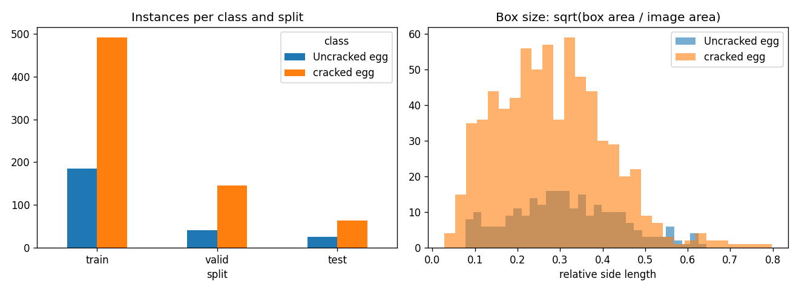
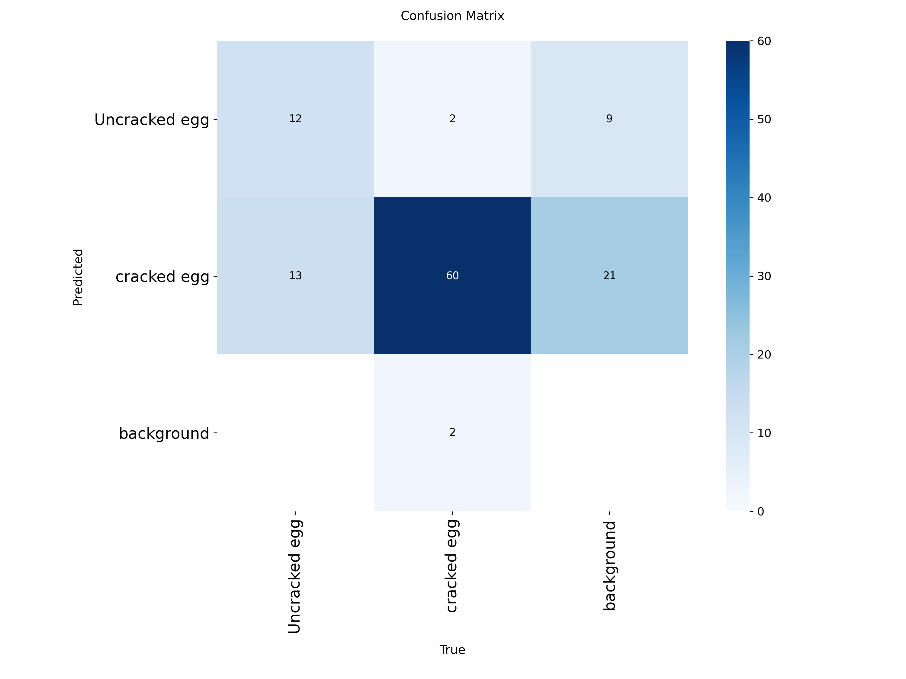
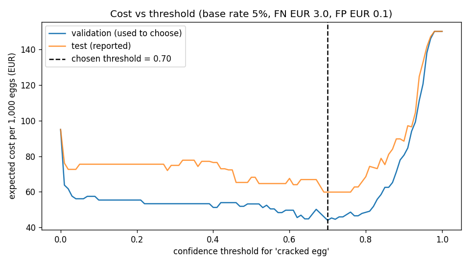

# Assignment 2 Report

- **Name**: Daniel Garcia Laya
- **Student ID**: 19122
- **Email**: dgarcia.ieu2022@student.ie.edu
- **Group**: BBADBA 5B

## Business problem, and the cost of being wrong

A small egg farm grades its own eggs, about 20,000 a day. Today an operator watches the line and takes out eggs with a broken shell before they go into retail boxes. My model would sit on a camera above that line and give every egg a "cracked" score. The score sends each egg to one of three places: pass (packed as a class A egg), review (an operator looks at it), or fail (sold to the industrial channel). The positive class is **cracked egg**.

The two mistakes do not cost the same.

**Missing a crack (false negative): €3.00 per egg.** EU rules say class A eggs must have an undamaged shell. A cracked egg in a box leaks onto the others and can make the retailer return the box or complain. It is also a food safety risk, because bacteria get in through the crack. €3 is roughly a box of eggs plus the cost of dealing with the complaint.

**Rejecting a good egg (false positive): €0.10 per egg.** The egg is not thrown away. It is sold for industrial use at a lower price. A dozen class M eggs sold for €2.60 to €2.85 in Spanish supermarkets in August 2026, and the packer gets less than that, so the gap between a table egg and an industrial egg is around 10 cents.

So a missed crack costs about 30 times more than a wasted good egg. This is why I care most about recall on cracked eggs, why the threshold is set to miss as few cracks as possible, and why it can be worth paying a person to look at an egg.

## Dataset

Roboflow Universe, workspace **dilusha-nadeeshan**, project **egg_damge_non_damage**, version **1**. It is public, used as it is and not forked, with a CC BY 4.0 licence.
https://universe.roboflow.com/dilusha-nadeeshan/egg_damge_non_damage/dataset/1

It is an object detection dataset with two classes, cracked egg and Uncracked egg. Each image is usually one egg, often held in a hand or lying on a table, the floor or soil. The author resized everything to 640×640 and added no augmentation.

It serves the decision because the decision is made one egg at a time and asks one thing: is the shell broken or not? That is exactly what each label says. To get one decision per egg, I take the highest cracked egg confidence in the image as that egg's score.

It only partly matches a real line, though. Most cracked eggs here are clearly smashed, while a packing line also has to catch thin hairline cracks. The photos are also handheld, not taken from a fixed camera over a conveyor.

## What the dataset's composition implies

I computed these numbers from the label files (artifacts/dataset_stats.json).

| Split | Images | Cracked egg boxes | Uncracked egg boxes | Images with a cracked egg |
|---|---|---|---|---|
| Train | 553 | 491 | 185 | 380 (69%) |
| Valid | 158 | 145 | 41 | 112 (71%) |
| Test | 79 | 64 | 25 | 52 (66%) |

Eggs are big in the frame. The median box covers 7% of the image for cracked eggs and 9% for good ones, and only 6% of boxes are smaller than 1% of the image. Most images have one box, and the most any image has is 5.

This tells me three things.

1. **The class balance is the opposite of real life.** Two thirds of the test eggs are cracked, but on a real line I expect about 5%. So I never cost the raw confusion matrix. Instead I measure how the model treats a cracked egg and how it treats a good egg, and reweight those two rates to a 5% base rate. Accuracy is also misleading here: calling every egg cracked already gets 66%.
2. **Good eggs are thin in the test set: only 25 boxes.** One good egg is 4% of that class, so the numbers for good eggs can easily move by a few points. Later I show that a single egg is enough to change which option looks cheapest.
3. **The test set does not look like production.** Random backgrounds, handheld photos and mostly smashed shells mean my test score is likely better than what I would see on a real line.

## Finetuning and baselines

I finetuned **yolo11s** for detection, starting from the COCO pretrained weights. I used detection because that is how the data is labelled. I picked the s size over n because the dataset is small enough to train it in minutes, and a crack is a small detail that benefits from a bigger model.

I trained in **Google Colab on a Tesla T4 GPU** by running `python main.py train`, with ultralytics 8.4.173. Settings: 100 epochs, patience 25, image size 640, batch 16, seed 0, default augmentation. It ran all 100 epochs in 16 minutes, and the best checkpoint is saved as weights/egg_crack_yolo11s.pt. I ran the pipeline twice and got the same results both times.

All models were compared on the same test split of 79 images.

| Model | AP50 | mAP50-95 | Eggs boxed (any label) | Recall on cracked | € per 1,000 eggs |
|---|---|---|---|---|---|
| **Finetuned yolo11s** | **0.789** | **0.764** | **92%** | **0.79** | **€59.88** |
| COCO yolo11s, zero shot | 0 | 0 | 51% | 0 | €150.00 |
| Predict nothing | 0 | 0 | 0% | 0 | €150.00 |
| Majority class (fail every egg) | n/a | n/a | n/a | 1.00 | €95.00 |

For the last two columns, the model decides alone at the threshold I picked on validation (0.70).

The COCO model has no "egg" class and no idea of "cracked", so its AP is zero by design. It does see the eggs, though. It boxes half of them but calls them mouse, bowl, sports ball or frisbee. Finetuning taught the model both the object and the difference between cracked and good. It beats both baselines on detection and on cost, cutting the cost from €150 to €60 per 1,000 eggs. The gap in accuracy against the majority baseline is small (0.76 against 0.66), which shows again that accuracy is the wrong thing to look at here.

## Per-class evaluation and failure modes

These are test results, at the confidence that gives the best F1.

| Class | Precision | Recall | AP50 | AP50-95 |
|---|---|---|---|---|
| **Cracked egg** (positive) | 0.640 | **0.953** | **0.814** | 0.779 |
| Uncracked egg | 0.747 | 0.720 | 0.765 | 0.749 |
| All | 0.694 | 0.837 | 0.789 | 0.764 |

This is the confusion matrix on test, counting boxes at confidence 0.25. Columns are the truth.

| Predicted / True | Uncracked egg | Cracked egg | Background |
|---|---|---|---|
| Uncracked egg | 12 | 2 | 9 |
| Cracked egg | **13** | 60 | **21** |
| Missed | 0 | 2 | |

The headline number comes from **cracked egg**: it finds 95% of them. It is also the bigger class, so the average makes the model look better than it is.

The model fails in three ways.

1. **It calls good eggs cracked.** This is the main failure. 13 of the 25 good eggs got a cracked box. Because the training data is mostly cracked eggs, when the model is unsure it leans towards "cracked". This mistake is cheap, but it is why the model cannot be trusted to pass eggs on its own.
2. **It adds extra cracked boxes on the background (21).** A smashed shell breaks into pieces, and the model often boxes the pieces separately. This hurts box precision but barely changes the egg decision, because I only use the top score per image.
3. **It misses some cracks completely.** Two cracked eggs in the test set got a score of 0. No threshold can catch them, so letting the model pass eggs alone always risks a €3 miss.

## Cost matrix and operating point

All the figures are in config.py, so the pipeline, the dashboard and this report always use the same numbers.

| | Model fails it | Model passes it | Sent to a person |
|---|---|---|---|
| **Really cracked** | €0 | **€3.00** | €0.013 for the time, plus a 5% chance the person misses it |
| **Really good** | **€0.10** | €0 | €0.013 for the time, plus a 1% chance the person rejects it |

Here is where each figure comes from.

- **€3.00 and €0.10:** explained in the first section.
- **True positives and true negatives cost €0.** A cracked egg sold for industry is worth what a cracked egg is worth, and a good egg packed is just the normal outcome.
- **A review costs €0.013.** That is an operator at €16 an hour, all costs included, spending 3 seconds per egg. I assumed a person catches 95% of cracks and wrongly rejects 1% of good eggs. These are my own assumptions, not measurements.
- **Base rate: 5% of eggs are cracked.** This is also an assumption. The dataset cannot tell me the real figure, because its 66% only comes from how it was collected. I test 2% to 10% below.

If the scores were true probabilities, the cost ratio alone would say: fail any egg above 0.10 / (0.10 + 3.00) = 0.03. But YOLO scores are not calibrated, and they were learned on data that is 66% cracked. So I swept the threshold instead.

I tried every threshold from 0 to 1 in steps of 0.01, worked out the expected cost per 1,000 real eggs at each one, and **picked the cheapest one on validation**. Then I report it on test, so the test set never influences the choice.

The best single threshold is **0.70**. It costs €44.03 per 1,000 eggs on validation and **€59.88 on test**. A bootstrap on the test eggs gives a 95% range of €38 to €83. The range is wide because the test set is small. The curve is fairly flat around the middle and shoots up above 0.85, where the model starts passing cracked eggs.

**The assumption that matters most is the cost of a missed crack, together with the base rate** (artifacts/sensitivity.csv). If a missed crack cost €10, the best threshold would fall to 0.03, and the model would fail almost everything. If it cost €1 and only 2% of eggs were cracked, the threshold would rise to 0.94. So 0.70 is only right while a miss costs around €2 to €3 and cracked eggs are a few percent of the flow.

## What a person still has to check

I swept every pair of thresholds on validation and kept the cheapest one. When two pairs cost the same, I kept the one that sends fewer eggs to a person.

The result: **pass below 0.00, review from 0.00 to 0.94, fail from 0.94.** In plain words, the model never passes an egg by itself. It only throws out eggs it is very sure are cracked, and a person looks at everything else. That follows from the failures above: some cracked eggs get a score of 0, so passing any egg without a look risks €3.

That sends **95.5% of eggs to a person, about 19,100 eggs a day.** At 3 seconds each, that is 15.9 hours of work, or **2.3 people** working 7 real hours a shift. This is realistic, because it is about the same staff a farm already needs to check every egg by hand (2.4 people). But it also means the model saves almost no labour. Its value is removing the obvious broken eggs before they reach the operator.

Here are the four options on the test set, at a 5% base rate.

| Option | € per 1,000 eggs | € per day | Sent to a person | People | Cracked eggs shipped per 1,000 |
|---|---|---|---|---|---|
| Do nothing | 150.00 | 3,000 | 0% | 0 | 50.0 |
| **Person checks every egg** | **21.78** | **436** | 100% | 2.4 | 2.5 |
| Model decides alone | 59.88 | 1,198 | 0% | 0 | 10.6 |
| **Model plus review** | **23.23** | **465** | 95.5% | 2.3 | **2.0** |

**What I conclude.** Model plus review and a person checking everything are basically tied, and both are far better than the other two options. Model plus review ships the fewest cracked eggs and needs slightly fewer people. A person checking everything is €1.45 cheaper per 1,000 eggs on test. On validation it was the other way round, because there model plus review cost €19.67. The difference comes from **one good test egg out of 27** that scored above 0.94 and was thrown out. That one egg is 3.7% of the good eggs, which on a real line means about 35 good eggs per 1,000 and around €3.50. It is the thin class problem from earlier, showing up in euros.

Letting the model decide alone is not acceptable. It ships 10.6 cracked eggs per 1,000, four times more than a person.

**What would change the decision is how long a person needs per egg** (artifacts/band_sensitivity.csv). Here I chose the thresholds again on validation each time and costed them on test, with a €3 miss and a 5% base rate.

| Seconds per review | Thresholds chosen | Model plus review | Person checks all |
|---|---|---|---|
| 3 | 0.00 to 0.94 | €23.2 | €21.8 |
| 5 | 0.02 to 0.94 | €30.6 | €30.7 |
| 10 | 0.40 to 0.94 | €54.2 | €52.9 |
| 20 | 0.70 (no review) | €59.9 | €97.3 |

If a check takes a few seconds, checking by hand is as good as anything the model offers. If a careful check takes 15 to 20 seconds, for example picking the egg up and holding it to a light, the model clearly pays for itself. The first thing I would measure on a real farm is how long a check really takes.

## Limitations & next steps

1. **The test set does not look like a real line.** I would take about 500 photos from the actual conveyor camera, label them, and rerun the costs on those before trusting any euro figure.
2. **Hairline cracks are almost missing.** Most cracked eggs here are smashed, which is the easy case. I would add backlit photos of hairline cracks, or combine the camera with the acoustic crack sensors that commercial graders already use, and report recall on hairline cracks on its own.
3. **Too few good eggs in test.** With 25 boxes, one egg changes the answer. I would build a bigger test set with enough good eggs and always report the cost with its range.
4. **The scores are not calibrated.** I would calibrate them on data with a realistic crack rate. Then the threshold could come straight from the cost ratio, and the sweep would be a check on it.
5. **Some labels look suspicious.** A few files named damaged contain boxes labelled Uncracked egg. I would check 100 random labels by hand to see how common real mistakes are.
6. **The review figures are my guesses.** That means 3 seconds per egg, 95% of cracks caught and 1% of good eggs wrongly rejected. I would time an operator on 200 flagged eggs and compare their calls with a second person.

## Generative AI use disclosure

I used Claude (Anthropic) as an assistant. It helped me write the code (config.py, decision.py, train.py, app.py) and find the dataset, and it also helped me work through the numbers for this report from the results my pipeline produced.
